# 🚀 @ipsadt/tg-widgets Showcase & Examples (Bot API 10.4)

Interactive showcase Telegram bot (`bot.tsx`) demonstrating all UI components, state management, client-side scripts, and server actions inside real Telegram messages.

<p align="center">
  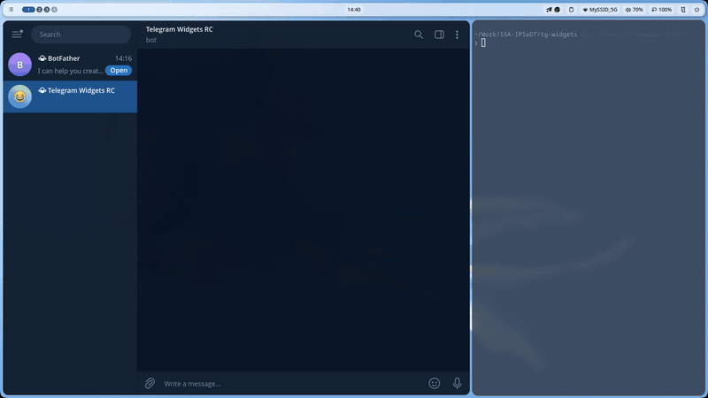
</p>
<p align="center">
  <em>⚡ Live showcase demo: Starting the bot with Bun on Telegram Test DC, sending <code>/start</code>, and navigating the 11 component screens.</em>
</p>

---

## 🛠️ Quick Start

### 1. Configure Environment Variables

Copy the sample environment file and provide your bot token:

```bash
cp .env.example .env
```

Edit `.env`:

```env
BOT_TOKEN=123456789:ABCdefGhIJKlmNoPQRsTUVwxyZ
# Enable to test on the Telegram Test DC:
TELEGRAM_TEST_ENV=false
```

> **Testing on Bot API 10.4 (Test DC):**
> For testing widgets in test groups or channels, set `TELEGRAM_TEST_ENV=true` in `.env`.

### 2. Run the Showcase Bot

```bash
# Using Bun (loads .env automatically)
bun run example

# Or run directly
bun run examples/bot.tsx

# Using Node.js with tsx
npx tsx examples/bot.tsx
```

### 3. Open Telegram

Send the `/start` command to your bot. The bot displays an interactive inline menu with all 11 screens. Each screen can also be invoked directly via its slash command.

---

## 📁 Examples Catalog & Screen Directory

Each example has a dedicated directory with source code, documentation, and a screenshot preview:

| Screen / Component   | Command       | Description                                                        | Source Code                             | Documentation & Preview                           |
| :------------------- | :------------ | :----------------------------------------------------------------- | :-------------------------------------- | :------------------------------------------------ |
| **Accordion**        | `/accordion`  | Native collapsible cards (`<details>` / `<summary>`) without JS    | [`screen.tsx`](./accordion/screen.tsx)  | [📖 accordion/README.md](./accordion/README.md)   |
| **Form Controls**    | `/controls`   | Checkbox, Switch, RadioGroup, and Stepper without `<input>` tags   | [`screen.tsx`](./controls/screen.tsx)   | [📖 controls/README.md](./controls/README.md)     |
| **Data Table**       | `/table`      | Native data table with receipt rows and download action            | [`screen.tsx`](./table/screen.tsx)      | [📖 table/README.md](./table/README.md)           |
| **Alerts & Badges**  | `/alerts`     | Status alert banners and badges with Lucide SVG icons              | [`screen.tsx`](./alerts/screen.tsx)     | [📖 alerts/README.md](./alerts/README.md)         |
| **Cards & Metrics**  | `/cards`      | Compound shadcn cards, progress bar, metric grids, and actions     | [`screen.tsx`](./cards/screen.tsx)      | [📖 cards/README.md](./cards/README.md)           |
| **Live Counter**     | `/counter`    | Real-time counter with client IIFE script and haptic vibration     | [`screen.tsx`](./counter/screen.tsx)    | [📖 counter/README.md](./counter/README.md)       |
| **Live Poll**        | `/poll`       | Community poll with animated percentage bars and live vote counts  | [`screen.tsx`](./poll/screen.tsx)       | [📖 poll/README.md](./poll/README.md)             |
| **E-Commerce**       | `/ecommerce`  | Product card, size selector, quantity stepper, and order checkout  | [`screen.tsx`](./ecommerce/screen.tsx)  | [📖 ecommerce/README.md](./ecommerce/README.md)   |
| **User Profile**     | `/profile`    | Profile card with preference switches and plain text fallback mode | [`screen.tsx`](./profile/screen.tsx)    | [📖 profile/README.md](./profile/README.md)       |
| **Chess Tournament** | `/tournament` | Event registration with role selection and Mini App deep links     | [`screen.tsx`](./tournament/screen.tsx) | [📖 tournament/README.md](./tournament/README.md) |
| **Crypto Wallet**    | `/crypto`     | TON balance card, currency conversion, copy address, and haptics   | [`screen.tsx`](./crypto/screen.tsx)     | [📖 crypto/README.md](./crypto/README.md)         |

---

## 🏗️ Architecture & Organization

All example screens follow the standard `@ipsadt/tg-widgets` contract:

- **`defineWidgetScreen({ id, component, initialState, actions })`**: Typed definition connecting JSX rendering, initial state, and server action handlers.
- **`WidgetLayout`**: Root container providing Telegram safe-area padding and responsive dimensions.
- **`<Script fn={...} args={[...]} />`**: Inlines a typed client-side IIFE into the widget HTML for optimistic UI updates and haptic events.
- **Compression Budget**: Every screen is optimized and minified with `html-minifier-terser`, verified to fit well within Telegram's strict 4096-byte deflate limit.

---

## 📸 Screen Media & Visual Previews

Every component screen includes high-resolution static captures, auto-playing interactive GIFs, and modern WebM videos demonstrating real-time Telegram client theme adaptation (Dark ⇄ Light mode):

| Screen               | Command       |           Animated Preview           |                  Static Capture                  |                HD Video                | Highlights                                                                    |
| :------------------- | :------------ | :----------------------------------: | :----------------------------------------------: | :------------------------------------: | :---------------------------------------------------------------------------- |
| **Accordion**        | `/accordion`  | [🎬 demo.gif](./accordion/demo.gif)  | [🖼️ screenshot.png](./accordion/screenshot.png)  | [📹 demo.webm](./accordion/demo.webm)  | Native disclosure `<details>`, smooth chevron rotation, theme adaptation.     |
| **Form Controls**    | `/controls`   |  [🎬 demo.gif](./controls/demo.gif)  |  [🖼️ screenshot.png](./controls/screenshot.png)  |  [📹 demo.webm](./controls/demo.webm)  | SVG switches, radios, checkboxes, numeric stepper, theme switching.           |
| **User Profile**     | `/profile`    |  [🎬 demo.gif](./profile/demo.gif)   |  [🖼️ screenshot.png](./profile/screenshot.png)   |  [📹 demo.webm](./profile/demo.webm)   | Avatar badge, toggles, graceful plain-text fallback toggle.                   |
| **Chess Tournament** | `/tournament` | [🎬 demo.gif](./tournament/demo.gif) | [🖼️ screenshot.png](./tournament/screenshot.png) | [📹 demo.webm](./tournament/demo.webm) | Volunteer/Player roles, live counters, Mini App launch button.                |
| **Crypto Wallet**    | `/crypto`     |   [🎬 demo.gif](./crypto/demo.gif)   |   [🖼️ screenshot.png](./crypto/screenshot.png)   |   [📹 demo.webm](./crypto/demo.webm)   | TON balance, native clipboard copy with haptic feedback, theme switching.     |
| **E-Commerce**       | `/ecommerce`  | [🎬 demo.gif](./ecommerce/demo.gif)  | [🖼️ screenshot.png](./ecommerce/screenshot.png)  | [📹 demo.webm](./ecommerce/demo.webm)  | Dynamic shoe size pills, live price calculation, order checkout toast.        |
| **Alerts & Badges**  | `/alerts`     |   [🎬 demo.gif](./alerts/demo.gif)   |   [🖼️ screenshot.png](./alerts/screenshot.png)   |   [📹 demo.webm](./alerts/demo.webm)   | Lucide vector banners (Info, Success, Warning, Error), custom accent borders. |
| **Cards & Metrics**  | `/cards`      |   [🎬 demo.gif](./cards/demo.gif)    |   [🖼️ screenshot.png](./cards/screenshot.png)    |   [📹 demo.webm](./cards/demo.webm)    | Compound shadcn cards, metric grid, accessible ProgressBar.                   |
| **Live Poll**        | `/poll`       |    [🎬 demo.gif](./poll/demo.gif)    |    [🖼️ screenshot.png](./poll/screenshot.png)    |    [📹 demo.webm](./poll/demo.webm)    | Optimistic vote selection, animated progress bar expansion, haptics.          |
| **Data Table**       | `/table`      |   [🎬 demo.gif](./table/demo.gif)    |   [🖼️ screenshot.png](./table/screenshot.png)    |   [📹 demo.webm](./table/demo.webm)    | Native `<table>`, receipts layout, theme-integrated list separators.          |
| **Live Counter**     | `/counter`    |  [🎬 demo.gif](./counter/demo.gif)   |  [🖼️ screenshot.png](./counter/screenshot.png)   |  [📹 demo.webm](./counter/demo.webm)   | IIFE client script, optimistic input lock, bidirectional server sync.         |

<details open>
<summary><b>🖼️ Visual Screenshot Gallery (All 11 Screens)</b></summary>
<br />

<p align="center">
  <a href="./accordion/">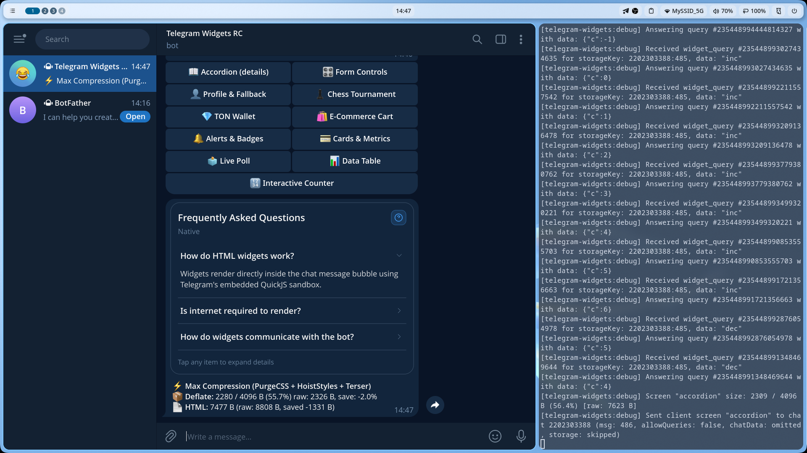</a>
  &nbsp;
  <a href="./controls/">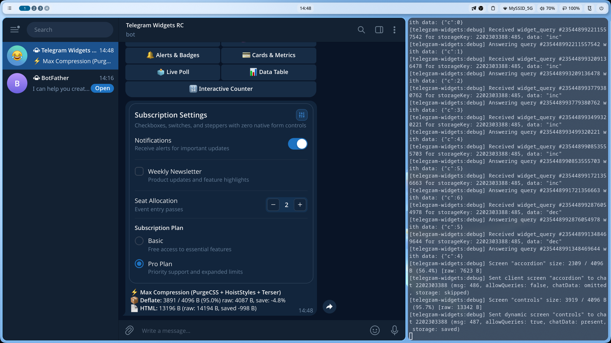</a>
  &nbsp;
  <a href="./profile/">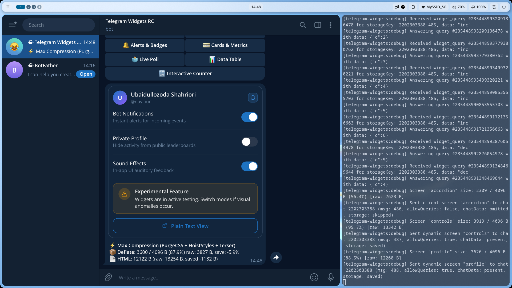</a>
</p>
<p align="center">
  <a href="./tournament/">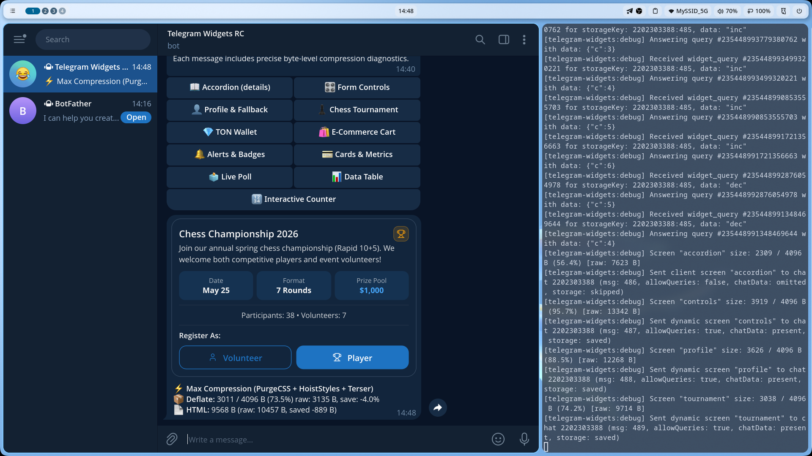</a>
  &nbsp;
  <a href="./crypto/">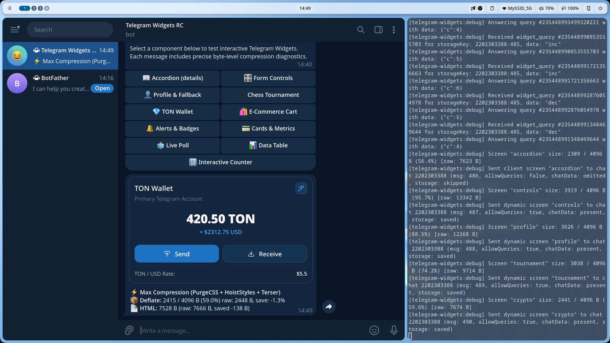</a>
  &nbsp;
  <a href="./ecommerce/">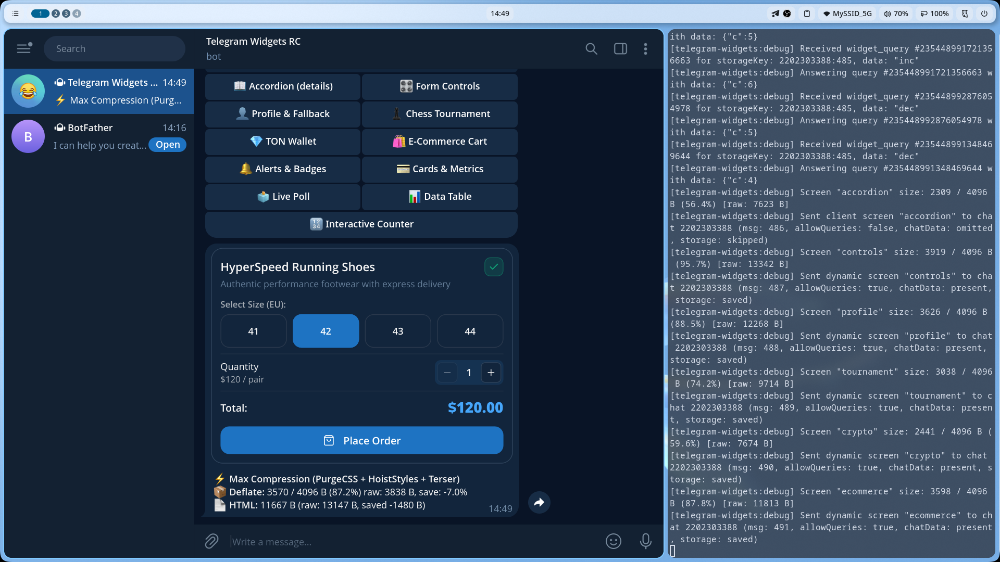</a>
</p>
<p align="center">
  <a href="./alerts/">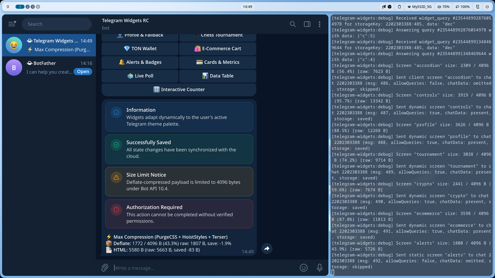</a>
  &nbsp;
  <a href="./cards/">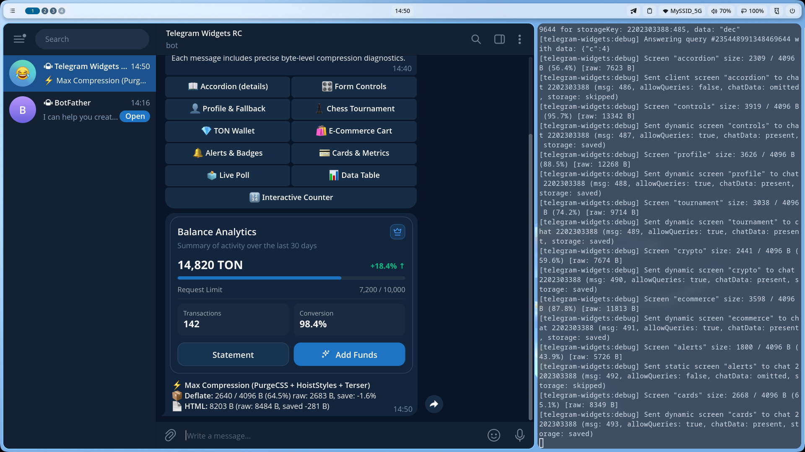</a>
  &nbsp;
  <a href="./poll/">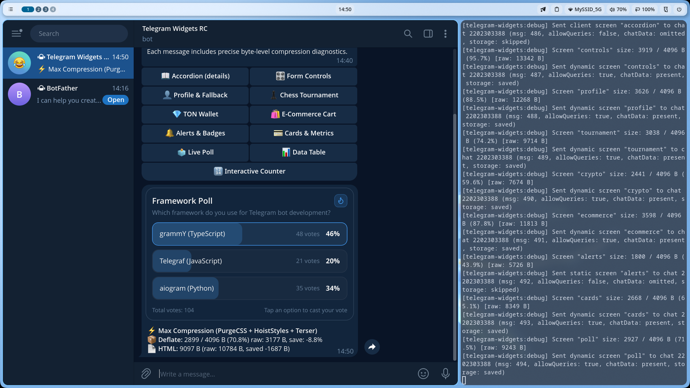</a>
</p>
<p align="center">
  <a href="./table/">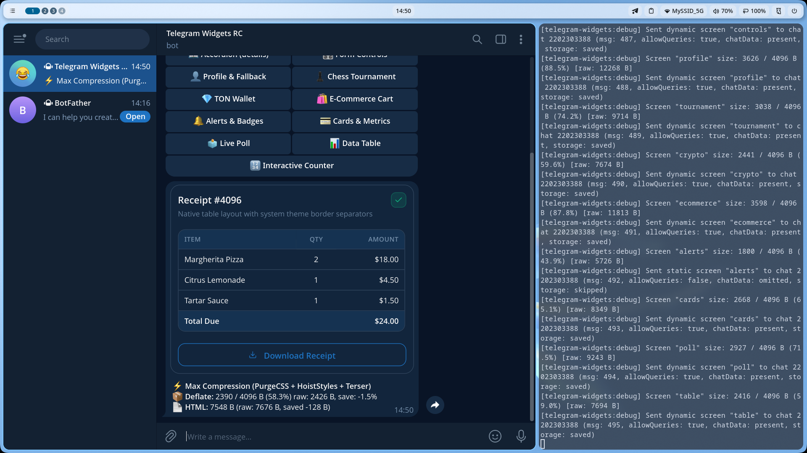</a>
  &nbsp;
  <a href="./counter/">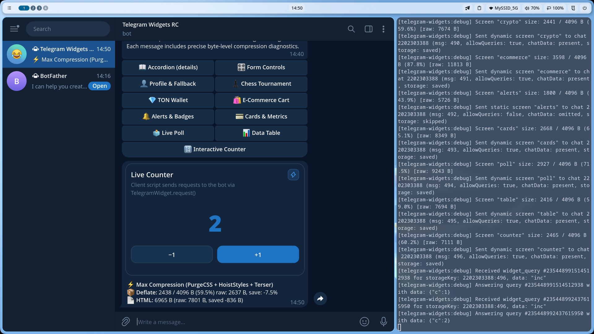</a>
</p>

</details>

> 💡 **Tip for Mobile Compact Mode**: Take screenshots on both mobile (Android/iOS) and desktop. On mobile, `WidgetLayout` automatically scales to narrow screens (320px–360px) maintaining strict `1:1` square aspect ratios on buttons.
