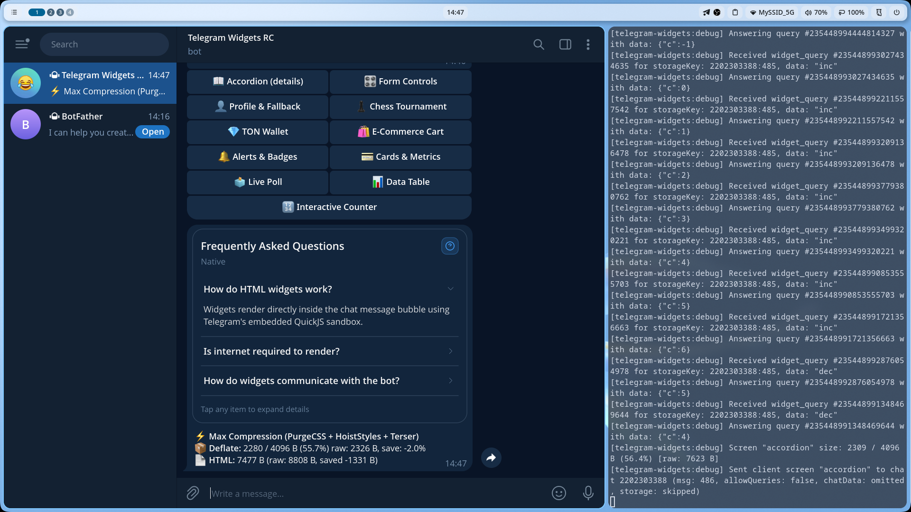

# 📖 Accordion & Collapsible (<details> / <summary>)

Компонент **`Accordion`** (и **`AccordionItem`** / **`Collapsible`**) предназначен для отображения раскрывающихся блоков, списков часто задаваемых вопросов (FAQ), детализации транзакций или спойлеров в виджетах Telegram.

Исходный код примера: [`screen.tsx`](./screen.tsx)

---

## 💡 Особенности реализации в Telegram Widgets

1. **100% нативный HTML**: Использует стандартные теги `<details>` и `<summary>`, которые официально поддерживаются спецификацией **Telegram QuickJS Profile 1**.
2. **0 байт JavaScript**: Раскрытие и закрытие блока происходит нативно средствами Telegram без подключения скриптов и без сетевых запросов.
3. **Плавная анимация шеврона**: Шеврон справа плавно поворачивается на 90° при открытии блока с помощью чистого CSS-правила:
   ```css
   details[open] .tg-accordion-chevron {
     transform: rotate(90deg) !important;
   }
   ```

---

## 💻 Код экрана (`screen.tsx`)

```tsx
import {
  Accordion,
  AccordionItem,
  Badge,
  Card,
  CardContent,
  CardDescription,
  CardFooter,
  CardHeader,
  CardTitle,
  Collapsible,
  defineWidgetScreen,
  h,
  WidgetLayout
} from '@ipsadt/tg-widgets';

export const accordionScreen = defineWidgetScreen({
  id: 'accordion',
  component: () => (
    <WidgetLayout safeArea>
      <Card>
        <CardHeader>
          <div style={{ display: 'flex', justifyContent: 'space-between', alignItems: 'center' }}>
            <CardTitle>Частые вопросы</CardTitle>
            <Badge variant="accent">Profile 1</Badge>
          </div>
          <CardDescription>
            Тестирование нативного элемента &lt;details&gt; в виджетах Telegram
          </CardDescription>
        </CardHeader>
        <CardContent>
          <Accordion>
            <AccordionItem title="Как работают HTML-виджеты?" open={true}>
              Виджеты рендерятся прямо внутри баббла сообщения с помощью встроенной песочницы QuickJS.
            </AccordionItem>
            <AccordionItem title="Нужен ли интернет для рендера?">
              Нет, виджет отрисовывается мгновенно в локальном офлайне.
            </AccordionItem>
            <Collapsible title="Как виджет общается с ботом?">
              Через вызов TelegramWidget.request(), доставляющий компактный запрос до 64 байт.
            </Collapsible>
          </Accordion>
        </CardContent>
        <CardFooter>
          <span style={{ fontSize: 11, color: 'var(--tg-theme-hint-color, #888)' }}>
            Нажмите на любой пункт, чтобы раскрыть
          </span>
        </CardFooter>
      </Card>
    </WidgetLayout>
  ),
  initialState: () => ({}),
});
```

---

## 🚀 Команда для проверки в боте

```text
/accordion
```

---

## 📸 Скриншот из Telegram

> *После тестирования добавьте сюда скриншот сообщения из Telegram с именем `screenshot.png`:*


