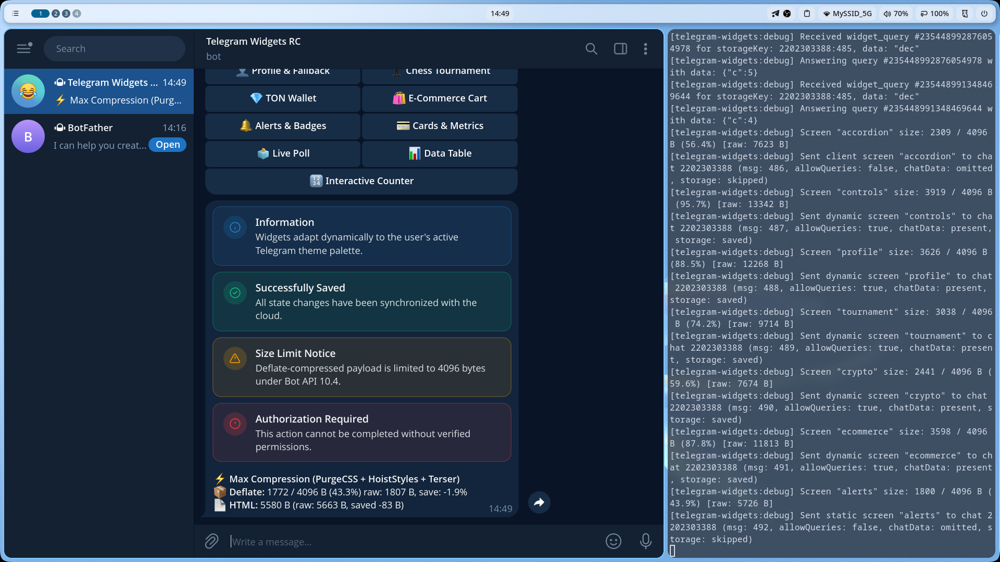

# 🔔 Alerts (Callouts & Status notifications)

Компоненты уведомлений и статусов в стиле shadcn/ui (`Alert`, `AlertTitle`, `AlertDescription`).

---

## 💡 Варианты и цвета темы

* `default` — нейтральный блок на базе `--tg-theme-secondary-bg-color`.
* `info` — информационный блок с синим акцентом (`--tg-theme-link-color`).
* `success` — зеленый блок подтверждения успешного действия.
* `warning` — желтый блок предупреждения.
* `destructive` — красный блок ошибок (`--tg-theme-destructive-text-color`).

---

## 💻 Пример использования в коде

```tsx
import { Alert, AlertDescription, AlertTitle, WidgetLayout } from '@ipsadt/tg-widgets';

export const StatusWidget = () => (
  <WidgetLayout gap={8} safeArea>
    <Alert
      variant="success"
      title="Оплата прошла успешно"
      description="Товар будет доставлен в течение 30 минут."
    />
    <Alert
      variant="warning"
      title="Превышен лимит запросов"
      description="Пожалуйста, подождите несколько секунд перед повторной отправкой."
    />
  </WidgetLayout>
);
```

---

## 📸 Скриншот из Telegram

> *После тестирования добавьте сюда скриншот сообщения из Telegram с именем `screenshot.png`:*


