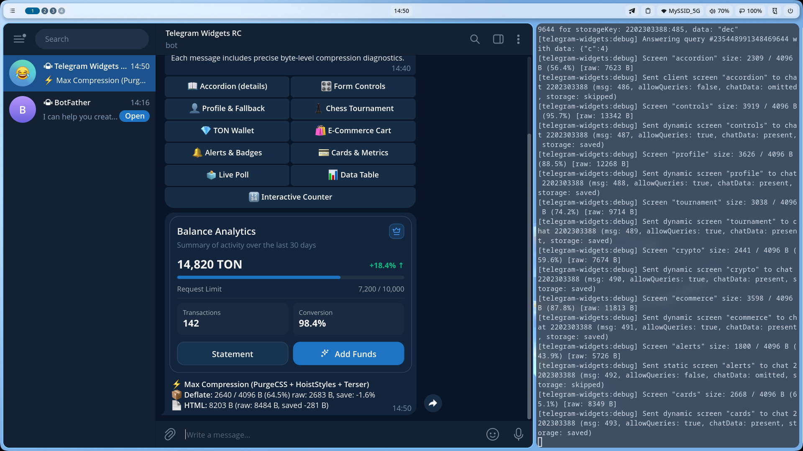

# 💳 Cards & Compound Structure

Карточки в стиле shadcn/ui с составной структурой (`CardHeader`, `CardTitle`, `CardDescription`, `CardContent`, `CardFooter`), прогресс-баром и бейджами.

Исходный код примера: [`screen.tsx`](./screen.tsx)

---

## 💻 Код экрана (`screen.tsx`)

```tsx
import {
  Badge,
  Button,
  Card,
  CardContent,
  CardDescription,
  CardFooter,
  CardHeader,
  CardTitle,
  defineWidgetScreen,
  h,
  Input,
  ProgressBar,
  Typography,
  WidgetLayout,
} from '@ipsadt/tg-widgets';

export const cardsScreen = defineWidgetScreen({
  id: 'cards',
  component: () => (
    <WidgetLayout gap={10} safeArea>
      <Card variant="default">
        <CardHeader>
          <div style={{ display: 'flex', justifyContent: 'space-between', alignItems: 'center' }}>
            <CardTitle>Аналитика аккаунта</CardTitle>
            <Badge variant="accent">Pro</Badge>
          </div>
          <CardDescription>
            Обзор активности за последние 30 дней
          </CardDescription>
        </CardHeader>
        <CardContent>
          <div style={{ display: 'flex', justifyContent: 'space-between', alignItems: 'baseline' }}>
            <Typography variant="title">14,820 TON</Typography>
            <span style={{ color: '#10b981', fontWeight: 600, fontSize: 13 }}>
              +18.4% ↑
            </span>
          </div>
          <ProgressBar percent={72} />
          <div
            style={{
              display: 'flex',
              justifyContent: 'space-between',
              fontSize: 12,
              color: 'var(--tg-theme-hint-color, #888)',
            }}
          >
            <span>Лимит запросов</span>
            <span>7,200 / 10,000</span>
          </div>
        </CardContent>
        <CardFooter>
          <Button variant="primary" fullWidth size="md">
            Увеличить лимит
          </Button>
        </CardFooter>
      </Card>

      <Card variant="outlined">
        <div style={{ fontSize: 13, fontWeight: 500, marginBottom: 6 }}>
          Поле быстрого действия:
        </div>
        <Input
          placeholder="Нажмите для ввода заметки..."
          action="promptNote"
        />
      </Card>
    </WidgetLayout>
  ),
  initialState: () => ({}),
});
```

---

## 🚀 Команда для проверки в боте

```text
/cards
```

---

## 📸 Скриншот из Telegram

> *После тестирования добавьте сюда скриншот сообщения из Telegram с именем `screenshot.png`:*


