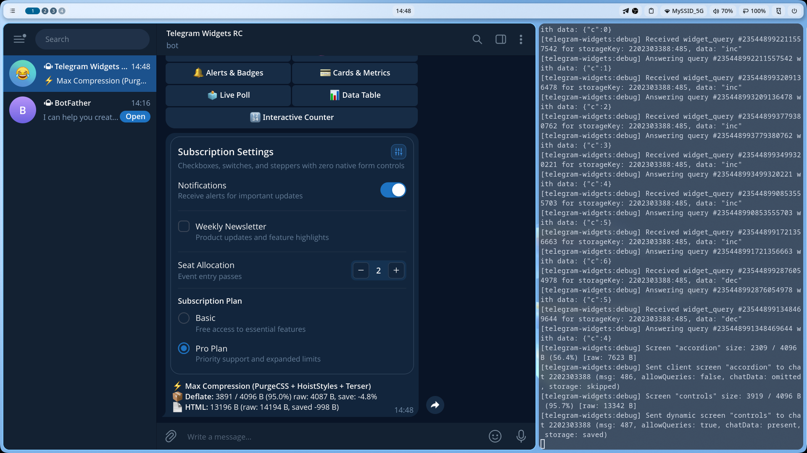

# 🎛️ Form Controls (Checkbox, Switch, Radio & Stepper)

Набор элементов управления для выбора настроек, параметров подписки или количества в Telegram Widgets.

---

## 💡 Особенности Profile 1

* **Никаких `<input>`**: Песочница Telegram удаляет все теги `<input>` и игнорирует CSS-селектор `:checked`.
* **Векторные SVG**: Чекбоксы и радио-кнопки отрисованы на чистых SVG без лишних ARIA/role атрибутов.
* **Степпер (`Stepper`)**: Поскольку текстовые поля с клавиатурой не поддерживаются, компонент `Stepper` (`− [ значение ] +`) является главным инструментом для числового ввода в виджетах.

---

## 💻 Пример использования в коде

```tsx
import {
  Card,
  Checkbox,
  Divider,
  Radio,
  RadioGroup,
  Stepper,
  Switch,
  WidgetLayout
} from '@ipsadt/tg-widgets';

export const SettingsWidget = ({ notify, count, plan }: { notify: boolean; count: number; plan: string }) => (
  <WidgetLayout safeArea>
    <Card>
      {/* Switch */}
      <Switch
        id="notify"
        checked={notify}
        action="toggleNotify"
        label="Уведомления"
        description="Получать сообщения о важных событиях"
      />

      <Divider />

      {/* Stepper */}
      <div style={{ display: 'flex', justifyContent: 'space-between', alignItems: 'center' }}>
        <span>Количество билетов</span>
        <Stepper
          value={count}
          min={1}
          max={10}
          decrementAction="countMinus"
          incrementAction="countPlus"
        />
      </div>

      <Divider />

      {/* Radio */}
      <RadioGroup gap={6}>
        <Radio
          value="basic"
          action="setPlan:basic"
          checked={plan === 'basic'}
          label="Базовый"
        />
        <Radio
          value="pro"
          action="setPlan:pro"
          checked={plan === 'pro'}
          label="Pro план"
        />
      </RadioGroup>
    </Card>
  </WidgetLayout>
);
```

---

## 📸 Скриншот из Telegram

> *После тестирования добавьте сюда скриншот сообщения из Telegram с именем `screenshot.png`:*


