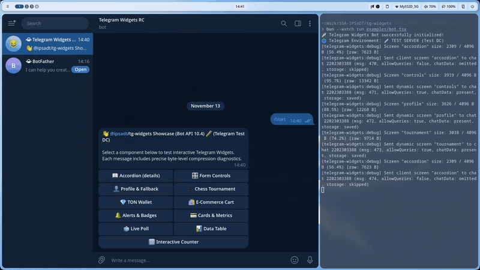

# 🎛️ Form Controls (Checkbox, Switch, Radio & Stepper)

Interactive form control collection featuring switches, checkboxes, radio groups, and steppers for Telegram Widgets without `<input>` tags.

Source code: [`screen.tsx`](./screen.tsx)

<p align="center">
  
</p>
<p align="center">
  <em>⚡ Live interaction: Toggling switch, incrementing/decrementing stepper, selecting radio options, and light/dark theme adaptation. <a href="./screenshot.png">Static Screenshot</a> · <a href="./demo.webm">HD WebM</a></em>
</p>

---

## 💡 Profile 1 Compatibility Highlights

- **Zero `<input>` tags**: The Telegram Widget sandbox purges `<input>` and `<form>` elements and ignores `:checked` CSS pseudo-classes.
- **Pure SVG Vector Controls**: Checkboxes and radio buttons render through SVG graphics, avoiding unsupported native form elements.
- **Numeric Stepper**: Since virtual keyboards are unavailable in widgets, the `Stepper` component (`− [ value ] +`) is the standard pattern for numeric input.
- **Client-Side Optimistic Updates**: Instant UI transitions powered by `window.TelegramWidget.request()` and haptic feedback.

---

## 🚀 Bot Command

```text
/controls
```

---

## 📸 Telegram Preview


