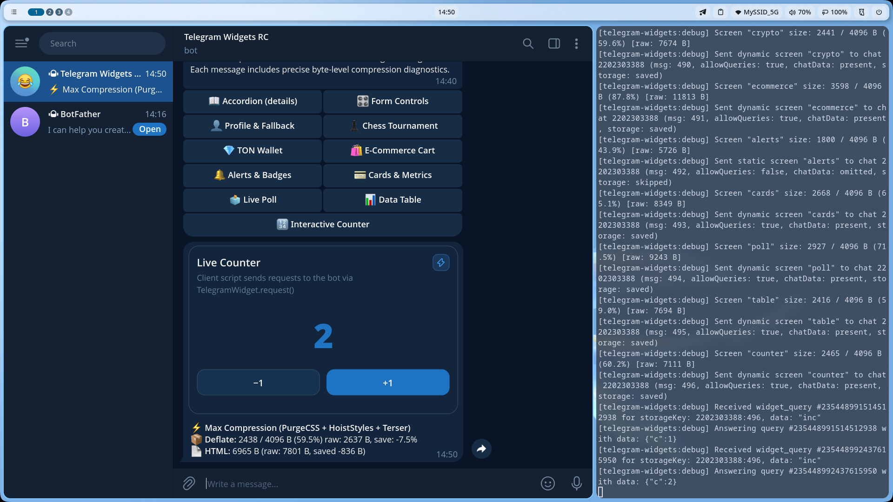

# 🔢 Live Counter (Client IIFE Script & Server Actions)

Interactive counter widget demonstrating bidirectional communication between client-side sandbox scripts (`<Script fn={...} />`) and server actions via `window.TelegramWidget.request()`.

Source code: [`screen.tsx`](./screen.tsx)

---

## 💡 How It Works

1. `<Script fn={clientCounterScript} args={[{ count }]} />` serializes the TypeScript function into a self-executing inline script (IIFE) inside the widget.
2. Clicking a button locks inputs in-flight and waits for the server response:
    ```ts
    window.TelegramWidget.request('inc')
        .then((response) => {
            // Synchronize response payload with client state
        })
        .finally(() => {
            // Unlock buttons
        });
    ```
3. The server receives the widget action via `update.widget_query`, runs the `inc` handler, persists updated state to storage, and responds via `answerWidgetQuery`.

---

## 🚀 Bot Command

```text
/counter
```

---

## 📸 Telegram Preview


