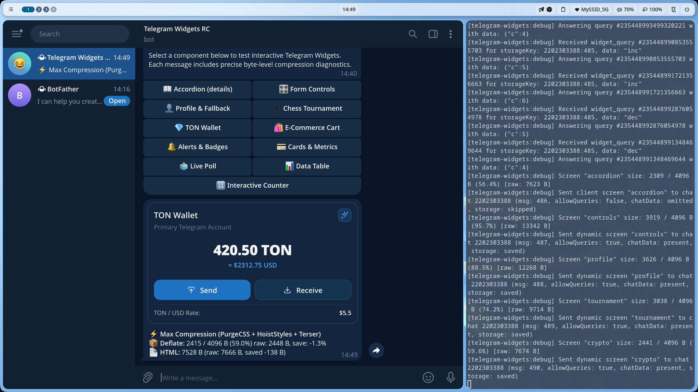

# 💎 TON Crypto Wallet

Card-based cryptocurrency wallet widget demonstrating balance presentation, quick transfer actions, clipboard copying, and haptic feedback.

Source code: [`screen.tsx`](./screen.tsx)

---

## 💡 Key Features

- **Financial Balance Card**: High-contrast balance typography with secondary fiat conversion calculation.
- **Dual Action Triggers**: Primary ("Send") and secondary ("Receive") buttons with embedded Lucide icons.
- **Native Clipboard Integration**: Client script invokes `window.TelegramWidget.copyText()` to copy sample wallet address.
- **Haptic Feedback**: Medium impact for transactions and success notifications on address copy.

---

## 🚀 Bot Command

```text
/crypto
```

---

## 📸 Telegram Preview

> *Add `screenshot.png` here after testing in Telegram:*


