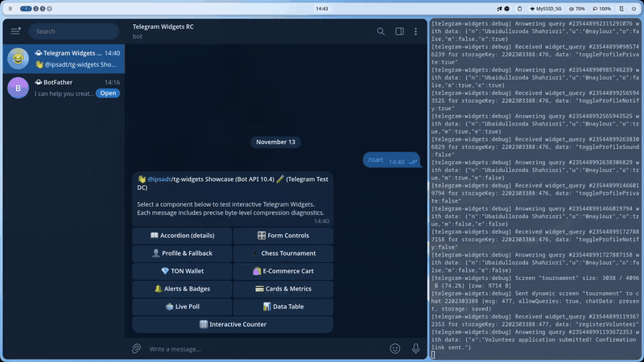

# 💎 TON Crypto Wallet

Card-based cryptocurrency wallet widget demonstrating balance presentation, quick transfer actions, clipboard copying, and haptic feedback.

Source code: [`screen.tsx`](./screen.tsx)

<p align="center">
  
</p>
<p align="center">
  <em>⚡ Live interaction: TON balance display, address copy with native haptics, and light/dark theme adaptation. <a href="./screenshot.png">Static Screenshot</a> · <a href="./demo.webm">HD WebM</a></em>
</p>

---

## 💡 Key Features

- **Financial Balance Card**: High-contrast balance typography with secondary fiat conversion calculation.
- **Dual Action Triggers**: Primary ("Send") and secondary ("Receive") buttons with embedded Lucide icons.
- **Native Clipboard Integration**: Client script invokes `window.TelegramWidget.copyText()` to copy sample wallet address.
- **Haptic Feedback**: Medium impact for transactions and success notifications on address copy.

---

## 🚀 Bot Command

```text
/crypto
```

---

## 📸 Telegram Preview


