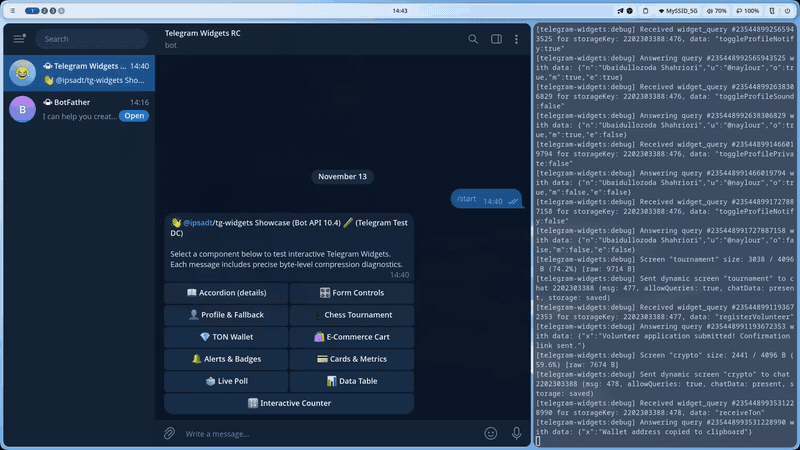
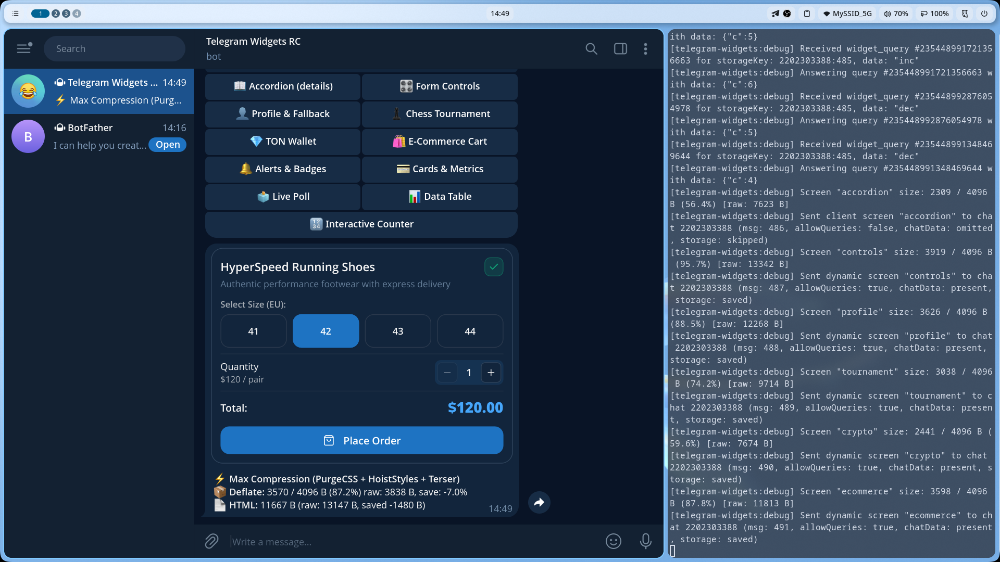

# 🛍️ E-Commerce Mini Cart & Checkout Widget

Interactive product card with variant selection, live subtotal computation, and checkout confirmation directly inside a Telegram message.

Source code: [`screen.tsx`](./screen.tsx)

<p align="center">
  
</p>
<p align="center">
  <em>⚡ Live interaction: Variant picker, stepper quantity adjustments, checkout, and theme switching. <a href="./screenshot.png">Static Screenshot</a> · <a href="./demo.webm">HD WebM</a></em>
</p>

---

## 💡 Key Highlights

1. **Size Variant Selector**: Toggle EU shoe sizes (41–44) with instant client-side active state styling.
2. **Dynamic Price Recalculation**: Adjusting quantity immediately recomputes the order total (e.g. `$120.00`) on the fly.
3. **Checkout Feedback**: Clicking "Place Order" triggers Telegram haptic feedback and displays a dismissible confirmation banner.
4. **SVG Lucide Icons**: Cart (`ShoppingBag`), increment/decrement, and checkmark icons bundled via `lucide-static`.

---

## 🚀 Bot Command

```text
/ecommerce
```

---

## 📸 Telegram Preview


