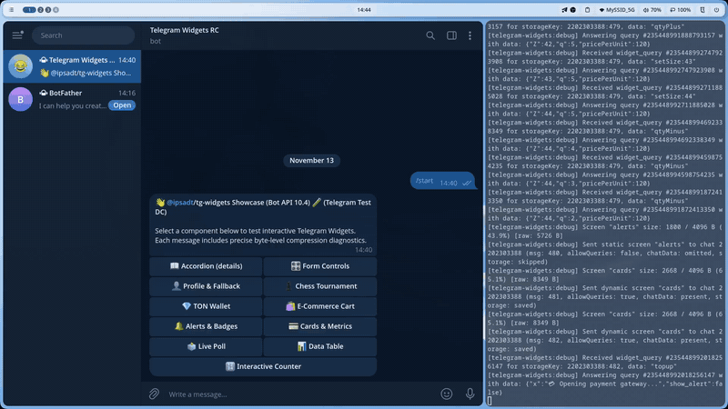
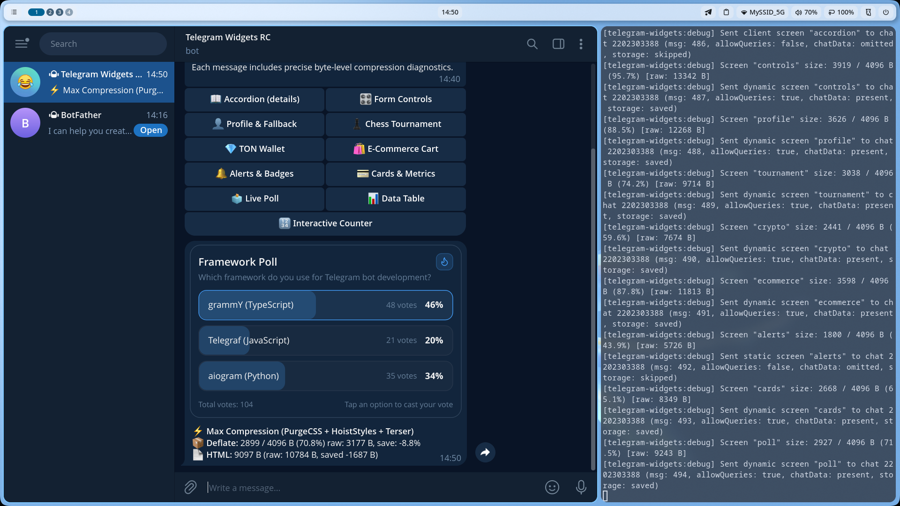

# 📊 Interactive Poll & Voting Widget

Interactive community poll with animated real-time percentage bars, haptic feedback, and server state synchronization.

Source code: [`screen.tsx`](./screen.tsx)

<p align="center">
  
</p>
<p align="center">
  <em>⚡ Live interaction: Voting, animated percentage progress bars, server sync, and theme adaptation. <a href="./screenshot.png">Static Screenshot</a> · <a href="./demo.webm">HD WebM</a></em>
</p>

---

## 💡 Key Highlights

1. **Optimistic UI Selection**: Tapping any option immediately recomputes the vote totals and percentage bars before server confirmation.
2. **Haptic Feedback**: Triggers medium impact vibration on mobile devices via `window.TelegramWidget.HapticFeedback.impactOccurred('medium')`.
3. **Server Synchronization**: Sends action request to grammY (`vote:grammy`), persists vote changes to storage, and answers the client query.

---

## 🚀 Bot Command

```text
/poll
```

---

## 📸 Telegram Preview


