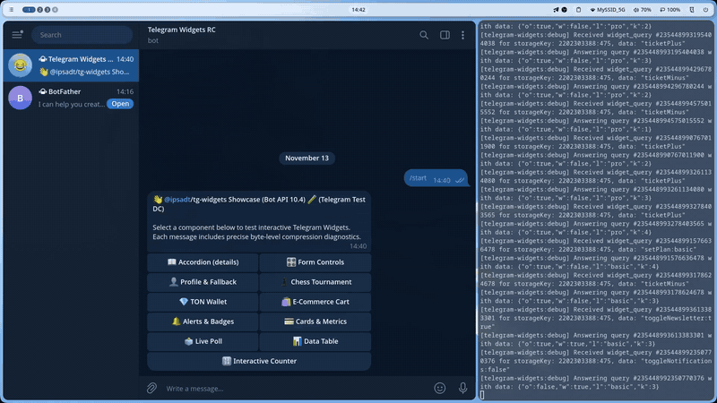
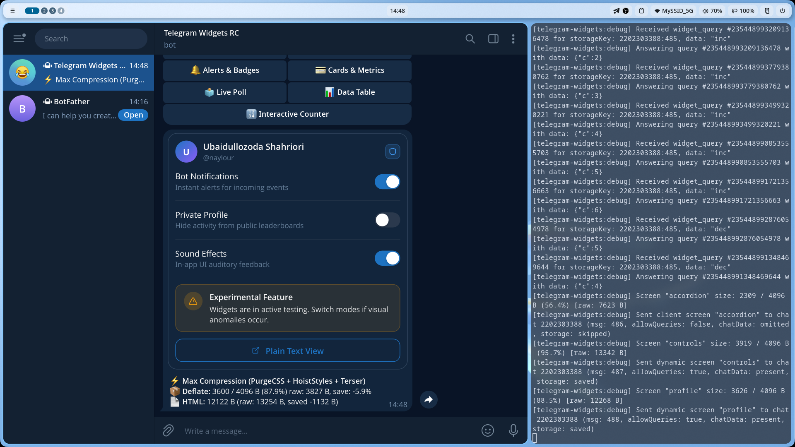

# 👤 User Profile & Settings Widget

User profile dashboard featuring custom avatar styling, preference switches, informational alerts, and fallback transitions to classic text messages.

Source code: [`screen.tsx`](./screen.tsx)

<p align="center">
  
</p>
<p align="center">
  <em>⚡ Live interaction: Toggling profile preferences, testing fallback plain text mode, and theme switching. <a href="./screenshot.png">Static Screenshot</a> · <a href="./demo.webm">HD WebM</a></em>
</p>

---

## 💡 Key Highlights

1. **Avatar & Badge Header**: CSS gradient avatar with user initials and Lucide Shield security badge.
2. **Preference Switches**: Reactive toggles for notifications, privacy, and sound effects with optimistic client-side updates.
3. **Graceful Fallback Mode**: "Plain Text View" button invokes `ctx.rawApi.editMessageText` to convert the widget back to a standard Telegram markdown message with an inline keyboard button to restore the widget.
4. **Experimental Alert Banner**: Warning banner styled using the `Alert` component.

---

## 🚀 Bot Command

```text
/profile
```

---

## 📸 Telegram Preview


