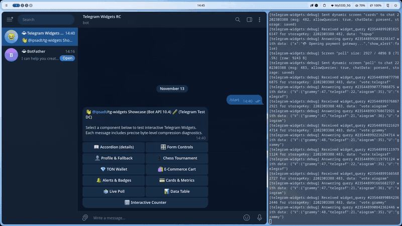

# 📊 Data Tables (Table, Header, Body, Footer)

Native data tables styled in the shadcn/ui aesthetic for receipts, invoices, leaderboards, and structured item lists in Telegram Widgets.

Source code: [`screen.tsx`](./screen.tsx)

<p align="center">
  
</p>
<p align="center">
  <em>⚡ Live interaction: Native structured data tables, receipts layout, and dark/light theme adaptation. <a href="./screenshot.png">Static Screenshot</a> · <a href="./demo.webm">HD WebM</a></em>
</p>

---

## 💡 Telegram Profile 1 Implementation Highlights

- **Full Native Table Elements**: Telegram Profile 1 officially supports `table`, `thead`, `tbody`, `tfoot`, `tr`, `th`, and `td`, along with `colspan` and `rowspan` attributes.
- **Theme-Integrated Separators**: Cell borders use `--tg-theme-section-separator-color`, matching Telegram's native system list aesthetics.
- **Custom Alignment**: Left, center, and right text alignment for headers and data cells.

---

## 🚀 Bot Command

```text
/table
```

---

## 📸 Telegram Preview


