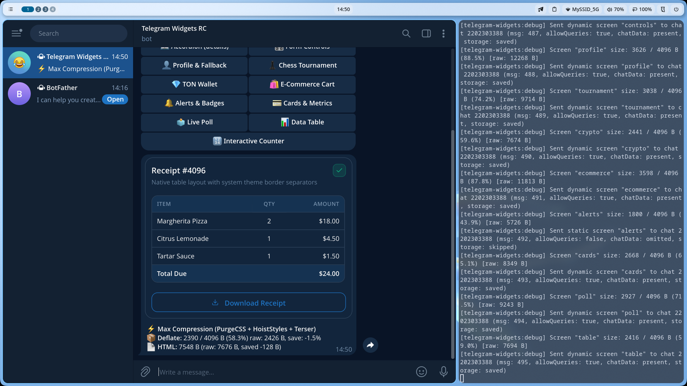

# 📊 Data Tables (Table, Header, Body, Footer)

Нативные таблицы данных в стиле shadcn/ui для отображения квитанций, счетов, лидербордов и списков позиций в Telegram Widgets.

Исходный код примера: [`screen.tsx`](./screen.tsx)

---

## 💡 Особенности реализации в Telegram

* Нативная поддержка: Telegram Profile 1 официально поддерживает теги `table`, `thead`, `tbody`, `tfoot`, `tr`, `th`, `td`, а также атрибуты `colspan` и `rowspan`.
* Разделители ячеек используют нативную переменную темы `--tg-theme-section-separator-color`, что делает таблицу неотличимой от системных списков Telegram.

---

## 💻 Код экрана (`screen.tsx`)

```tsx
import {
  Badge,
  Button,
  Card,
  CardContent,
  CardDescription,
  CardFooter,
  CardHeader,
  CardTitle,
  defineWidgetScreen,
  h,
  Table,
  TableBody,
  TableCell,
  TableFooter,
  TableHead,
  TableHeader,
  TableRow,
  WidgetLayout,
} from '@ipsadt/tg-widgets';

export const tableScreen = defineWidgetScreen({
  id: 'table',
  component: () => (
    <WidgetLayout safeArea>
      <Card>
        <CardHeader>
          <div style={{ display: 'flex', justifyContent: 'space-between', alignItems: 'center' }}>
            <CardTitle>Чек заказа #4096</CardTitle>
            <Badge variant="success">Оплачено</Badge>
          </div>
          <CardDescription>
            Пример нативной таблицы с системными границами ячеек
          </CardDescription>
        </CardHeader>
        <CardContent>
          <Table>
            <TableHeader>
              <TableRow>
                <TableHead>Позиция</TableHead>
                <TableHead align="center">Кол-во</TableHead>
                <TableHead align="right">Сумма</TableHead>
              </TableRow>
            </TableHeader>
            <TableBody>
              <TableRow>
                <TableCell>Пицца Маргарита</TableCell>
                <TableCell align="center">2</TableCell>
                <TableCell align="right">18.00 $</TableCell>
              </TableRow>
              <TableRow>
                <TableCell>Лимонад цитрусовый</TableCell>
                <TableCell align="center">1</TableCell>
                <TableCell align="right">4.50 $</TableCell>
              </TableRow>
              <TableRow>
                <TableCell>Соус тар-тар</TableCell>
                <TableCell align="center">1</TableCell>
                <TableCell align="right">1.50 $</TableCell>
              </TableRow>
            </TableBody>
            <TableFooter>
              <TableRow>
                <TableCell colspan={2}>Итого к оплате</TableCell>
                <TableCell align="right">24.00 $</TableCell>
              </TableRow>
            </TableFooter>
          </Table>
        </CardContent>
        <CardFooter>
          <Button variant="outline" fullWidth size="sm">
            Скачать квитанцию
          </Button>
        </CardFooter>
      </Card>
    </WidgetLayout>
  ),
  initialState: () => ({}),
});
```

---

## 🚀 Команда для проверки в боте

```text
/table
```

---

## 📸 Скриншот из Telegram

> *После тестирования добавьте сюда скриншот сообщения из Telegram с именем `screenshot.png`:*


