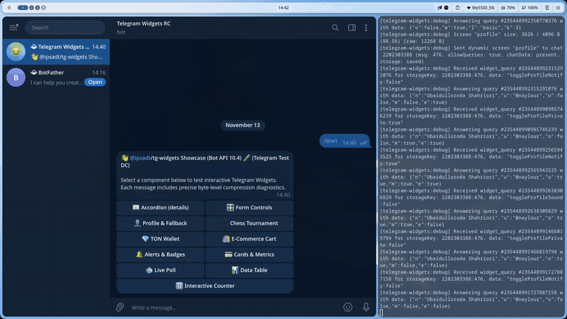

# 🏆 Chess Tournament Registration Widget

Event registration widget featuring role selection (Volunteer vs Player), live registration tallies, and Telegram Mini App launcher.

Source code: [`screen.tsx`](./screen.tsx)

<p align="center">
  
</p>
<p align="center">
  <em>⚡ Live interaction: Role selection, live registration tallies, and theme switching. <a href="./screenshot.png">Static Screenshot</a> · <a href="./demo.webm">HD WebM</a></em>
</p>

---

## 💡 Key Highlights

1. **Dual Registration Roles**: Allows users to apply as either a volunteer or a competitive player with live tally counters.
2. **Telegram Mini App Integration**: Invokes `window.TelegramWidget.openTelegramLink()` or deep links (`tg://resolve?domain=bot&app=...`) to transition the user directly into a full-screen Mini App.
3. **Floating Confirmation Banner**: Displays a non-intrusive toast notification inside the card on successful registration.
4. **Information Tiles**: Compact presentation of event metadata (date, format, prize pool).

---

## 🚀 Bot Command

```text
/tournament
```

---

## 📸 Telegram Preview


